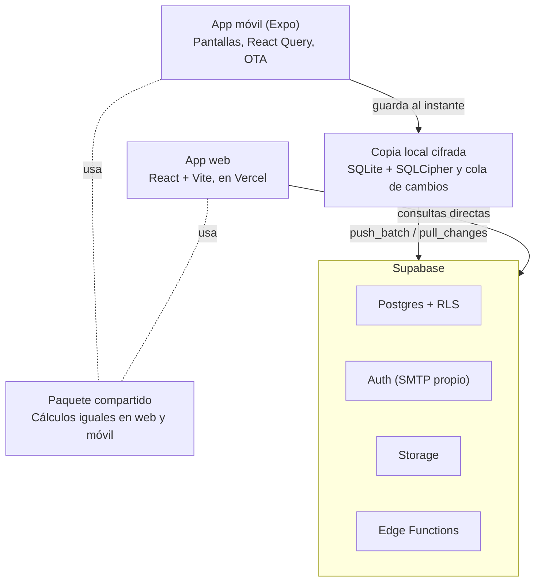

# Guía para construir una app Dark

Actualizada: 2026-10-29. Copia en el repo del documento compartido «Guía para construir una app Dark»
(https://claude.ai/artifact/W9yEMA1hfkqkKnCJfW2B9j). Si cambias una, cambia la otra.

## Para quién es

Toda app nueva de la familia Dark copia la arquitectura de DarkMoney: misma pila, mismas capas, mismas reglas de base de datos y de publicación. Esta guía es para programadores que no conocen DarkMoney y van a construir otra app guiándose por ella.

DarkMoney son tres repos que se usan juntos:

| Repo | Qué es | Dónde mirar primero |
| --- | --- | --- |
| DarkMoneyApp | App móvil (Expo / React Native) para Android e iPhone | `CLAUDE.md`, `docs/APP_DESIGN_AND_CODE_PATTERNS.md` |
| DarkMoney | App web (Vite + React) | `CLAUDE.md`, `AGENTS.md`, `docs/DESIGN-SYSTEM.md` |
| DarkMoneyShared | Cálculos compartidos entre web y móvil | `README.md` |

Cómo usarla: lee las reglas de oro antes de escribir código. Usa las demás secciones como lista de comprobación al arrancar el proyecto. Cuando una regla diga «como en DarkMoney», abre el archivo que se nombra y copia el patrón, no lo reinventes.

## Arquitectura de referencia

Una app Dark es un proyecto de Supabase con dos clientes, móvil y web, que comparten los cálculos. El móvil guarda primero en el teléfono y envía después.

| Pieza | Tecnología en DarkMoney | Para qué |
| --- | --- | --- |
| App móvil | Expo SDK 54, React Native 0.81, expo-router 6 | Pantallas, navegación, builds con EAS |
| App web | React 18, Vite 7, Tailwind 3, despliegue en Vercel | Mismo producto en navegador |
| Datos en el cliente | TanStack React Query 5 (caché persistida y cifrada en el móvil) | Consultas, mutaciones, invalidaciones |
| Servidor | Supabase: Postgres con RLS, Auth, Storage, Edge Functions (Deno), pg_cron | Datos, permisos, lógica de servidor |
| Copia en el teléfono | expo-sqlite con SQLCipher, motor propio en `lib/offline/**` | Trabajar sin red y sincronizar solo |
| Cálculos compartidos | Paquete `@darkmoney/shared` (ESM + CommonJS) | Que web y móvil den los mismos números |
| Actualizaciones | EAS Update (OTA) con `scripts/publish-ota.mjs` | Arreglos de JS sin reinstalar la app |

El móvil nunca espera al servidor para guardar: escribe en su copia cifrada y la cola se envía sola con `push_batch`; la web consulta Supabase directo.

## Arrancar un proyecto nuevo

El primer día se deja montada la base que en DarkMoney costó meses corregir después. Marca cada punto antes de escribir la primera pantalla.

- [ ] Proyecto de Supabase dentro de la organización de pago, con cómputo Micro o superior (el plan gratuito se queda sin memoria y congela la base).
- [ ] Primera migración con el modelo de espacios: tabla de espacios y miembros, `workspace_id` en cada tabla y la función `is_workspace_member()` para las políticas (copia `supabase/migrations/202606100001_base_schema_rls.sql`).
- [ ] RLS encendido en TODAS las tablas desde su creación, con políticas que usen `(select auth.uid())`.
- [ ] Tabla `app_error_logs` y `lib/error-logger.ts` con su límite de ráfagas: sin esto no hay forma de saber qué pasó en el teléfono de alguien.
- [ ] Sesión como en DarkMoney: `lib/auth-context.tsx`, `lib/secure-session-storage.ts` (llavero, en trozos) y `lib/stored-session.ts` (entrar con la sesión guardada si la red falla al abrir).
- [ ] `lib/query-client.ts` con la caché persistida y cifrada, y `lib/fetch-timeout-budget.ts` con los plazos de red.
- [ ] `app.json` con `runtimeVersion.policy = appVersion`, proyecto en EAS y los scripts `ota` y `build:android` (con `scripts/publish-ota.mjs` y `scripts/preflight-native-version.mjs`).
- [ ] `constants/theme.ts` con los tokens de color, espacios, radios y fuentes; nada de colores sueltos.
- [ ] `constants/changelog.ts` y `docs/CHANGELOG_STYLE.md` para las novedades que ve el usuario.
- [ ] `CLAUDE.md` propio, copiado del de DarkMoney y sin lo que es de finanzas.
- [ ] CI en GitHub que corra `npm run typecheck` y `npm test` (copia `.github/workflows/ci.yml`), y un respaldo diario automático de la base, con una restauración probada al menos una vez.

## Estructura del código

Una pantalla compone; no calcula ni consulta. Cada cosa vive en su capa, y un componente visual nunca habla con Supabase.

| Carpeta | Qué va ahí | Qué NO va |
| --- | --- | --- |
| `app/*` | Rutas: orquestan estado, consultas, callbacks y piezas | Llamadas a Supabase, reglas de negocio largas |
| `components/ui/*` | Componentes genéricos (botones, hojas, listas, tarjetas) | Nada del dominio ni consultas |
| `components/domain/*`, `features/*/components/*` | Envoltorios del dominio que reciben datos listos | Supabase, React Query |
| `features/*/hooks` | Controladores: coordinan consultas, mutaciones y estado | Estilos |
| `features/*/lib` | Funciones puras: filtros, presentadores, cálculos, etiquetas | React, React Native, Supabase |
| `services/queries/*` | Supabase, React Query, mapeadores e invalidaciones | Componentes visuales |
| `lib/*` | Infraestructura reutilizable (sesión, errores, motor sin conexión) | Componentes visuales |

- Pantallas de recurso (listas con filtros) usan `ResourceModuleTemplate` en este orden: encabezado, barra de filtros, filtros activos, contexto, resumen, acciones masivas, lista, botón flotante, capas.
- Antes de crear una lista, tarjeta, filtro o resumen, busca el componente compartido; no se duplican.
- Estilos solo con los tokens de `constants/theme.ts`.
- Si un módulo se abre desde «Más», la ruta lleva `?from=more` y el botón Atrás usa `useOriginBackNavigation`.
- La regla completa, con nombres de archivos y el patrón de pantalla, está en `docs/APP_DESIGN_AND_CODE_PATTERNS.md`.

## Base de datos y seguridad

La base es la única fuente de verdad y la que protege los datos: cada regla de permisos vive en Postgres, no en la app.

- **Migraciones:** todo cambio de esquema es un archivo nuevo en `supabase/migrations/` con fecha (`AAAAMMDDNNNN_nombre.sql`). Nunca se edita una migración ya aplicada.
- **Ensayo antes de producción:** una migración se prueba primero dentro de `BEGIN` + `ROLLBACK` contra la base real, y después se aplica y se registra en `supabase_migrations.schema_migrations`.
- **Diccionario:** cada tabla, columna, tipo o vista nueva se documenta en `DATABASE_DICTIONARY.md` antes de cerrar la tarea.
- **RLS en todo:** sin excepción, con políticas por miembro del espacio. Lo que un usuario escribe para otro (por ejemplo una notificación) va por una función del servidor, nunca desde el teléfono.
- **Sin duplicados al reintentar:** toda alta que el usuario dispara lleva `client_dedupe_key` con un índice único `(workspace_id, client_dedupe_key)`. Un reintento por red lenta devuelve la fila existente en vez de crear otra (ver `lib/idempotency.ts`).
- **Dinero:** `numeric(14,2)` en Postgres y centavos enteros en el teléfono; nunca `float` ni `REAL`.
- **Operaciones de varias filas** (un pago que crea movimiento y evento): una función del servidor o un grupo atómico del motor sin conexión, nunca dos llamadas sueltas desde la app.
- **Secretos:** solo en los secretos de las Edge Functions y en `.env` local (fuera de git). Nunca en el código de la app ni en una OTA.

## Modo sin conexión

Si la app registra cosas en la calle (gastos, ventas, visitas), usa el motor sin conexión de DarkMoney desde el principio. Guarda en el teléfono al instante y envía después: el usuario nunca espera a la red ni pierde un registro.

Cómo funciona:

- **Copia local cifrada:** SQLite con SQLCipher; la llave vive en el llavero del teléfono, nunca junto al archivo.
- **Cola de cambios:** cada escritura queda en una cola con su ID ya reservado en el servidor (`reserve_ids`) y se envía sola con `push_batch`.
- **Descarga incremental:** `pull_changes` trae solo lo cambiado desde la última vez; `sync_live_ids` detecta lo borrado en otro dispositivo.
- **Grupos atómicos:** las operaciones que escriben varias filas viajan juntas y el servidor las aplica todas o ninguna.
- **Conflictos:** gana el último que escribe, campo por campo; un cambio de dinero sobre algo que otra persona ya cambió queda marcado para revisar.
- **Interruptor:** se enciende en Ajustes y, apagado, la app funciona como siempre.

Para reutilizarlo:

1. Copia `lib/offline/**` y las migraciones `202610120001` a `202610170001` del servidor.
2. Registra las tablas de tu app en `sync_tables` (la lista blanca de lo que se sincroniza y si se puede escribir).
3. Ajusta `lib/offline/schema.ts` a tus tablas y escribe tus consultas para leer de la copia local cuando esté lista (`useOfflineLocalReady`).
4. Corre `npm run test:offline-e2e` (el motor contra tus migraciones reales en Postgres local) y después la prueba en el teléfono de `docs/OFFLINE_DEVICE_TEST.md`.

El diseño completo está en `docs/OFFLINE_ENGINE_DESIGN.md` y en los planes `docs/OFFLINE_PHASE*`.

## Sesión, errores y mala señal

La app se escribe para 3G y para un servidor lento, no para el wifi de la oficina. En DarkMoney casi todas las quejas de «se demora» eran la app esperando al servidor sin necesidad.

- **Guardar no espera al servidor:** el botón termina cuando el dato quedó guardado en el teléfono. Lo demás (marcar avisos, aprendizaje, estadísticas, recargas) va en segundo plano y nunca dentro del `onSuccess` esperado de una mutación.
- **Lo que depende de que una fila exista en el servidor** espera a que llegue (`whenSent` en `lib/offline/ensure-sent.ts`); no se intenta antes ni se descarta.
- **Abrir la app sin red:** si renovar el permiso de acceso falla o tarda, se entra con la sesión guardada (`lib/stored-session.ts`). Mandar a iniciar sesión con mala señal deja al usuario fuera justo cuando más lo necesita.
- **Plazos de red:** todo `fetch` lleva un tiempo máximo (`lib/fetch-timeout-budget.ts`): lecturas 12 s, escrituras 25 s y 5 s en los 20 s que siguen a volver del segundo plano.
- **Reintentos:** un envío que no llegó se reintenta solo a los 5, 10, 20 s, hasta 5 minutos. La barra dice «N por enviar · reintentando».
- **Registro de errores:** todo error y cada arranque («app usable en N ms», con su versión) van a `app_error_logs`, con límite de ráfagas para no ahogar la base cuando ya está lenta.
- **Nada de Realtime:** la app se pone al día al abrirla, al volver a ella y por avisos push. En DarkMoney, Realtime congelaba la base varias veces al día para casi nada.

## Publicar

Un cambio solo de JavaScript llega por OTA a todos los teléfonos sin reinstalar. Un cambio nativo exige un APK o IPA nuevo y subir la versión.

| Qué cambió | Cómo se publica | Ojo |
| --- | --- | --- |
| Solo JS o imágenes | `npm run ota -- "descripción"` | Publica a la versión actual y a las viejas de `LEGACY_RUNTIMES`; nunca `eas update` a mano |
| Código nativo, permisos o paquetes nativos | Subir `version` y `versionCode` en `app.json`, luego `npm run build:android` | El preflight bloquea el build si hay cambios nativos sin subir versión |
| iPhone sin Mac | Workflow de GitHub que compila el IPA + Sideloadly | Con Apple ID gratis caduca a los 7 días |
| Forma de los datos guardados en caché | Subir el `buster` de `lib/query-client.ts` | Si no, la app abre con datos de la forma vieja |

- Publica desde una copia limpia del repo (un `git worktree` en el commit publicado), nunca desde una carpeta con cambios sin guardar: la OTA empaqueta lo que haya.
- Una versión sale de `LEGACY_RUNTIMES` solo cuando consta que nadie la usa. Antes, mira qué versiones aparecen en `app_error_logs` de los últimos días.
- El teléfono descarga la OTA al abrir y la aplica en la siguiente apertura completa: para probar, cierra la app del todo y ábrela dos veces.
- Toda mejora que el usuario note va a `constants/changelog.ts`, en palabras de alguien que nunca tocó un sistema (`docs/CHANGELOG_STYLE.md`).
- Un cambio no está listo hasta probarlo en el teléfono. `BUILD SUCCESSFUL` o las pruebas en verde no lo garantizan.

## Web y móvil iguales

Un mismo dato debe dar el mismo número en la web y en el teléfono. Si no, el usuario deja de confiar en ambas.

- **Reglas en el servidor primero:** lo que calcula una vista o función de Postgres sale igual en los dos clientes sin esfuerzo.
- **Paquete compartido:** los cálculos que viven en el cliente (conversión de moneda, agregaciones, proyecciones) van a un paquete propio como `@darkmoney/shared`, que publica ESM para la web y CommonJS para el móvil.
- **Cuándo extraer:** al segundo lugar que necesita el mismo cálculo, no antes.
- **Pruebas de paridad:** el móvil genera un resultado esperado sobre datos de prueba y la web lo reproduce (`tests/parity/` en ambos repos). Si no coinciden, falla la CI.
- **Copia local:** si un cálculo del servidor también se hace en el teléfono para el modo sin conexión, se compara con datos reales del servidor antes de publicarlo. En DarkMoney así se verificaron los saldos, el inicio y el resumen de contactos.

## Reglas de oro

Cada regla salió de un error real en DarkMoney. Rompe una y el problema vuelve.

| Regla | Qué pasó en DarkMoney |
| --- | --- |
| Nunca un `require` de un paquete nativo sin comprobar antes que el binario lo trae (`hasNativeModule`, `lib/native-module.ts`) | Una OTA cerró la app en un iPhone con una versión anterior justo después del Face ID |
| Publicar las OTA a todas las versiones vivas | Un arreglo «no llegó» a quien tenía otra versión, sin ningún error que avisara |
| Probar en el teléfono, siempre | 19 pruebas automáticas en verde y el deslizamiento de filas seguía fallando en iPhone |
| Mirar el código de salida de cada comando antes de commitear | Comandos encadenados dejaron pasar pruebas que fallaban hasta producción |
| Nada de esperar al servidor al guardar | «Guardando…» de 5 a 8 segundos con el dato ya guardado en el teléfono |
| Medir contra los datos reales toda regla que oculta algo | Tres reglas de «no mostrar» escondían cosas que sí había que ver |
| Mensajes de error largos y propios, en la lista blanca de `lib/errors.ts` | Los avisos de más de 120 caracteres se reemplazaban por uno genérico |
| Un commit por unidad lógica, nunca `git checkout` sobre trabajo sin guardar | Se perdió trabajo en un refactor largo |
| No mezclar la sesión con la red | Con 3G la app mandaba a iniciar sesión aunque la sesión estaba viva |

## Lista para mudarse de servidor

Cuando haya tres o más apps, la idea es mudarlas juntas a un servidor propio (Supabase autoalojado con Coolify en Hetzner, región Ashburn). Cada app que cumpla esto se muda repitiendo los mismos pasos, no reescribiéndola.

- **La dirección del servidor sale de una variable**, nunca escrita en el código. En el móvil debe poder cambiarse por OTA, sin APK.
- **Todo el esquema está en migraciones** del repo; nada creado a mano en el panel de Supabase.
- **Las Edge Functions y sus secretos están listados** en el repo (nombres, no valores) para poder recrearlos.
- **Las tareas programadas (pg_cron) y los webhooks** están en migraciones o documentados, con sus URLs en un solo lugar.
- **Los archivos de Storage** se pueden descargar y volver a subir con un script.
- **El correo de la autenticación usa un SMTP propio**, no el de Supabase.
- **Respaldo y restauración probados:** si nunca se restauró, no hay respaldo.

Mudar DarkMoney se estima en 3 a 5 días. Las siguientes apps, con este orden, deberían tomar mucho menos.

## Documentos de referencia

| Documento | Repo | Para qué |
| --- | --- | --- |
| `CLAUDE.md` | DarkMoneyApp | Todas las reglas de la app móvil, en un solo lugar |
| `docs/APP_DESIGN_AND_CODE_PATTERNS.md` | DarkMoneyApp | Capas, nombres y patrón de pantalla |
| `docs/OFFLINE_ENGINE_DESIGN.md` | DarkMoneyApp | Diseño del modo sin conexión |
| `docs/OFFLINE_DEVICE_TEST.md` | DarkMoneyApp | Prueba del modo sin conexión en el teléfono |
| `docs/OFFLINE_ENCRYPTION.md` | DarkMoneyApp | Cifrado de la copia local y de la caché |
| `docs/CHANGELOG_STYLE.md` | DarkMoneyApp | Cómo escribir las novedades para el usuario |
| `docs/BUILD_APK.md` | DarkMoneyApp | Compilar Android y verificar que el cambio entró |
| `docs/BUILD_IPA_GITHUB.md` | DarkMoneyApp | Compilar el IPA de iPhone sin Mac |
| `docs/REINSTALL_IOS.md` | DarkMoneyApp | Reinstalar en iPhone con Apple ID gratis |
| `docs/swipe-audit-2026-09-26.md` | DarkMoneyApp | El fallo de gestos en iOS y cómo probarlo |
| `CLAUDE.md` y `AGENTS.md` | DarkMoney | Reglas de la web |
| `docs/DESIGN-SYSTEM.md` | DarkMoney | Sistema de diseño de la web |
| `README.md` | DarkMoneyShared | Paquete compartido y pruebas de paridad |
